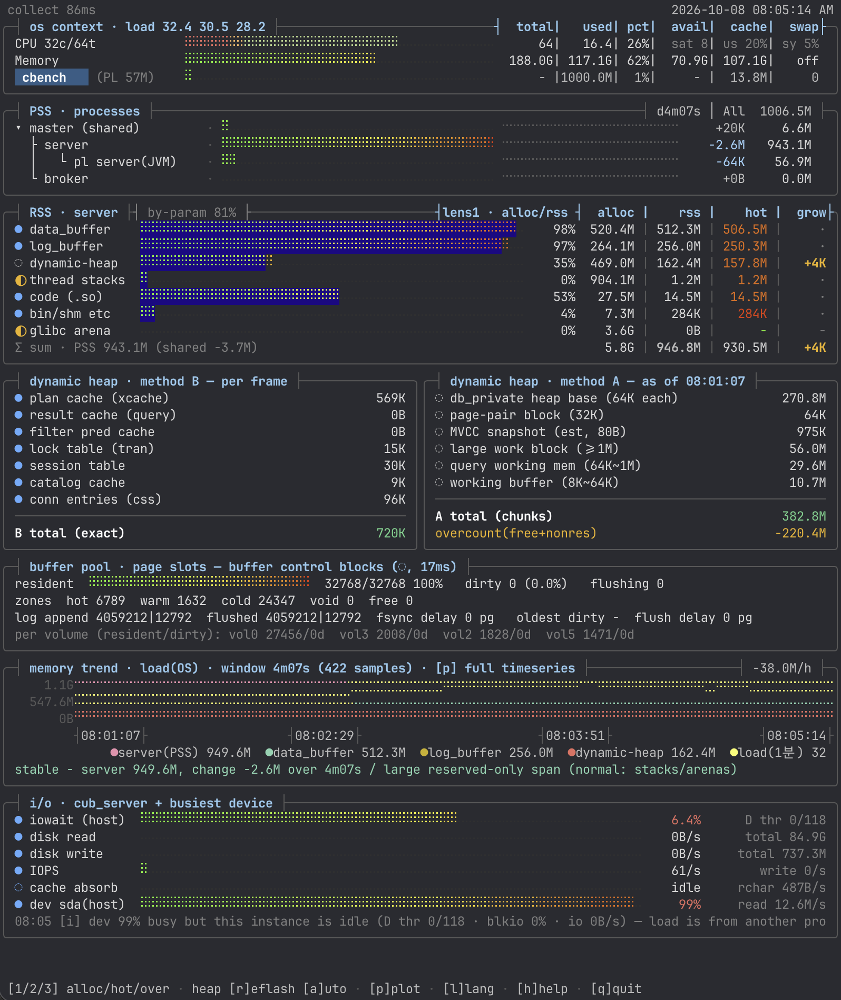
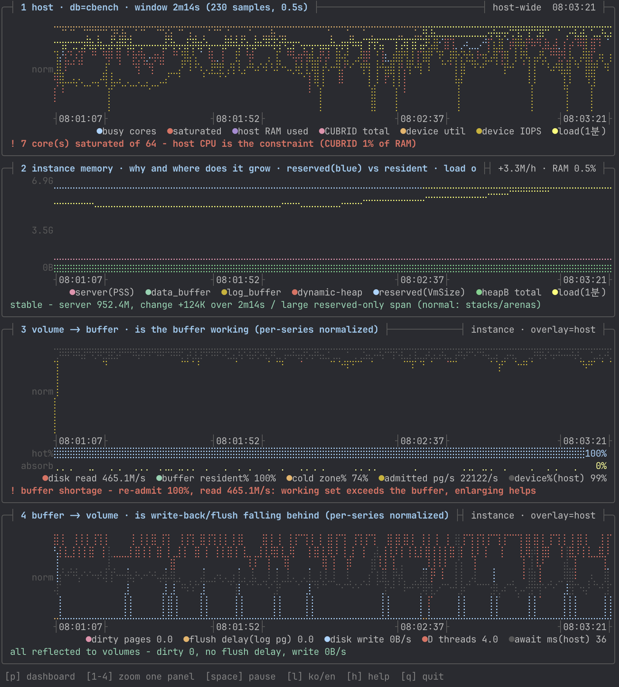
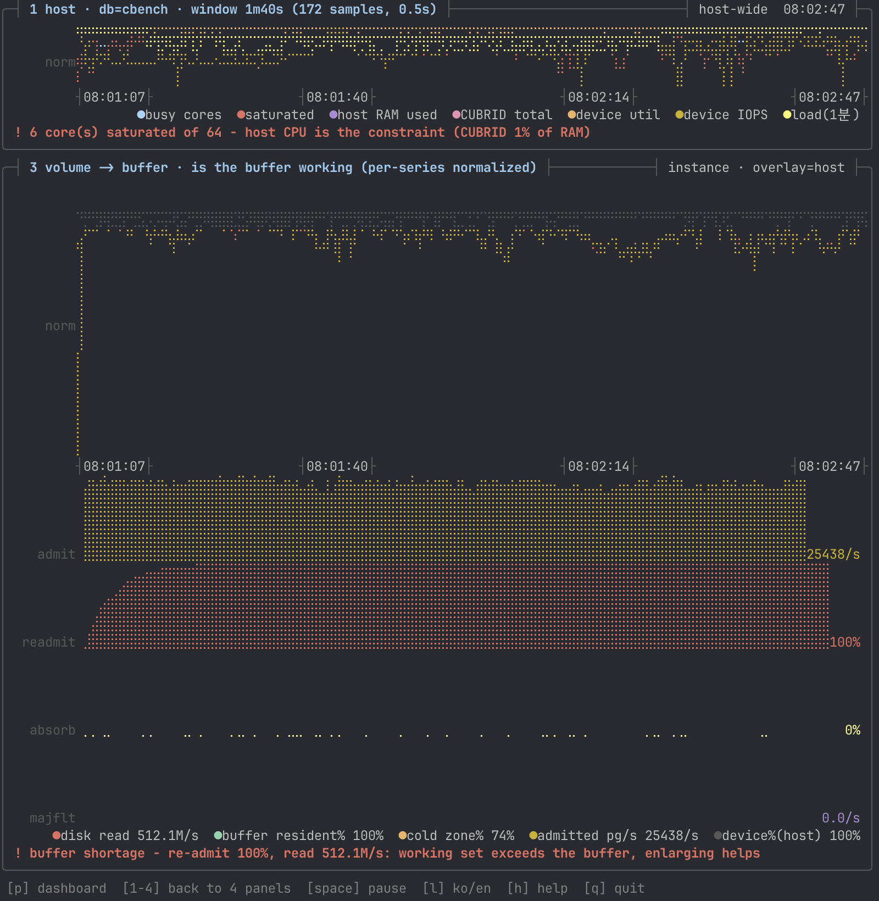

# cub_top

CUBRID 서버가 메모리를 **어디에 얼마나** 쓰고 있는지 `cubrid.conf` 파라미터 이름으로 보여주는 진단 유틸리티.
cub_top 자신은 **서버에 접속하지 않고** `/proc` 과 프로세스 메모리를 읽는다. 서버에 묻는 것은
대상 서버마다 `cubrid paramdump` 1회(실제 적용 중인 파라미터)뿐이다 — 시작할 때, 그리고 서버가 재시작·기동되거나 대상을 바꿀 때.
서버가 매핑한 설치본의 `cubrid` 를 서버와 같은 `CUBRID_DATABASES` 로 `-C` 실행하므로 버전이 어긋나지 않는다. 못 읽으면 사유만 적고 스스로 다시 시도하지 않는다 — 시계열·대시보드 전환(`p`) 때 다시 읽는다.

## 무엇을 푸는가

`top` 은 `cub_server` 가 1GB 를 쓴다고만 알려준다. 그 1GB 가 데이터 버퍼인지, 플랜 캐시인지,
설정을 초과한 것인지는 알려주지 않는다.

| 질문 | 답하는 방식 |
|---|---|
| 이 메모리가 어느 파라미터 몫인가 | 영역별 매핑을 `data_buffer_size` 등 설정 크기와 대조 |
| 설정으로 설명 안 되는 몫은 무엇인가 | 동적 힙을 서브시스템별로 분해 (방법 B=엔진 직독, A=청크 추정) |
| 설정값을 초과했는가 | `alloc / cfg` 비율 + 초과가 정상인 이유 병기 |
| 버퍼가 제 역할을 하는가 | 버퍼 상주율과 디스크 읽기량의 관계 + 한 줄 판정문 |
| 증설·축소 중 무엇이 답인가 | 수요·관측 상한·헤드룸 + 재적재율(버퍼 2배 시 줄어드는 읽기의 추정치, LRU 가정) |
| 어느 DB 가 얼마를 쓰는가 | 인스턴스별 집계(브로커·CAS·PL 포함) |
| 어느 페이지가 버퍼풀에 올라와 있는가 | BCB 직독 → `--bcb-dump` → `cub_volmap --bufmap` 으로 볼륨 지도에 중첩 |
| 장애 순간을 나중에 다시 볼 수 있는가 | `--record` 로 기록, `--replay` 로 어디서든 재생 |

## 원칙

cub_top 은 **서버를 띄운 CUBRID 설치 계정**으로 실행하는 것을 전제로 한다. 그 권한으로 볼 수 있는 모든
서버 프로세스의 사용 내역을 **비침습·최소 리소스**로 보여주는 것이 목표다. 모니터링을 위해 대상에 부하를
만드는 기능은 두지 않는다 — 정확히 보여주려면 부하가 드는 값은 보여주지 않는 쪽을 택한다.
그래서 최근 접근 비율(핫)은 없다: 재려면 대상 페이지 테이블을 전수 순회하는 `clear_refs` 쓰기가 필요하기 때문이다.

## 특징

| | |
|---|---|
| **대상에 쓰기 0** | 서버 정지·디버거·파라미터 변경·락 없음. 서버 질의는 대상 서버마다 `paramdump` 1회(재시작·대상 전환 시 다시, 자동 재시도 없음)이고 라이브 화면을 멈추지 않는다 |
| **접촉 최소** | 엔진 직독은 엔진이 원래 늘 만지는 구조(전역 변수·BCB 배열·LRU 집계)만 읽는다. 페이지 헤더는 오프셋 검증용 표본 256개(엔진이 최근 쓴 존, 상주 확인 후)만. 버퍼 슬롯 26만 개(4GB) 초과 버퍼풀은 배열 전수 스캔 대신 엔진 집계를 보인다([limitations](docs/limitations.md)) |
| **의존 0** | 단일 파일 C99, libelf/libdw 미링크. `<elf.h>` 는 선언만 사용 |
| **파일 하나로 전 버전** | 10.0~11.5 오프셋 표를 바이너리에 내장 — 바이너리만 복사해도 구버전에서 동작 |
| **자기검증 없이 값을 내지 않음** | 오프셋 표는 후보일 뿐. 그 환경에서 검증 실패 시 **그 기능만** 끄고 사유를 적는다 |
| **신뢰도를 숨기지 않음** | `●` 측정 / `◐` 예약 / `◌` 추정 / `?` 미귀속 을 행마다 표기 |
| **엔진 어휘로 표기** | `anon`·`file-backed` 가 아니라 `data_buffer`·`plan cache` 로 |
| **관측이 대상을 위협하지 않음** | 취합이 0.5초 예산을 넘으면 그 프레임을 버리고 화면에 알린다 |

## 빌드

빌드 산출물은 리포에 두지 않는다 — 어느 커밋·툴체인으로 만들어졌는지 확인할 수 없고,
소스를 고쳐도 따라 갱신되지 않기 때문이다. 의존성이 없어 빌드는 한 줄이다.

```sh
sh tools/build.sh           # 동적 (현재 시스템, 가장 호환성 높음)
sh tools/build.sh static    # 정적 단독 바이너리
sh tools/build.sh legacy    # 구 시스템(CentOS 6 등) — 대상에서 직접 빌드할 것
```

**CUBRID 소스도 헤더도 필요 없다.** libc 만 있으면 된다.

> 정적 빌드는 *빌드 환경 glibc 가 요구하는 커널 버전* 이상에서만 돈다.
> `readelf -n cub_top` 의 `NT_GNU_ABI_TAG` 로 하한을 확인한다.

## 사용

```sh
./cub_top -t                   # 드릴다운 트리 (터미널용, 1회 출력)
./cub_top -d                   # key=value 덤프 (모니터링 연동)
./cub_top --dump-json          # -d 와 같은 내용·같은 순서를 JSON 으로
./cub_top -b                   # btop형 대시보드 (라이브, -i 와 같음)
./cub_top -p                   # 시계열 플롯 (4패널, p 로 대시보드와 전환)
./cub_top -t <db명>            # 그 DB 를 본다 (생략 시 알파벳순 첫 번째)
./cub_top                      # 도움말 (옵션 목록) — -h, --help 와 같음
```



라이브 대시보드(`-b`) — 위에서부터 OS 컨텍스트, 프로세스별 RSS(top 기준), 서버 메모리의 파라미터 귀속
(`alloc`·`rss`·`conf`), 동적 힙 분해(방법 B 엔진 직독), 버퍼풀 슬롯(BCB)
직독, 메모리 추이, I/O 와 판정문 순이다. 이 화면(`cbench`)에서는:

| 상자 | 읽는 법 |
|---|---|
| RSS · server | `data_buffer` 는 설정 크기 520.4M 중 512.3M 가 상주한다(alloc/rss 98%). `glibc arena` 3.6G 는 예약만 하고 상주 0 이다 |
| dynamic heap | 방법 B 합계 720K(플랜 캐시 569K 포함)는 엔진 변수를 직접 읽은 정확값이다 |
| buffer pool | 32,768 슬롯이 모두 찼고(100%) 그중 cold 존이 24,347 — 버퍼가 가득 찬 채 페이지가 교체되고 있다 |
| memory trend | 4분 7초 동안 서버 변화 −2.6M, 안정 |
| i/o | 장치(sda)는 99% 바쁘지만 이 순간 이 인스턴스의 디스크 I/O 는 0B/s 라, 판정문이 부하를 **다른 프로세스**로 돌린다 |



시계열 플롯(`-p`) — 같은 데이터를 시간축으로 본다. 네 패널이 데이터가 흐르는 순서를 따르고, 패널마다
아래에 한 줄 판정문이 붙는다.

| 패널 | 묻는 것 | 이 화면의 판정 |
|---|---|---|
| 1 host | 호스트 자원 중 무엇이 제약인가 | 64 코어 중 7개 포화 — 호스트 CPU 가 제약(CUBRID 는 RAM 의 1%) |
| 2 instance memory | 서버 메모리가 왜·어디서 늘어나는가 | 안정 — 2분 14초 동안 +124K |
| 3 volume → buffer | 읽기 경로: 버퍼가 제 역할을 하는가 | 읽기 465.1M/s — 재적재율로 버퍼를 2배로 늘렸을 때 줄어들 읽기를 추정한다 |
| 4 buffer → volume | 쓰기 경로: write-back 이 밀리는가 | 볼륨 반영 완료 — dirty 0, flush 지연 없음, 쓰기 0B/s |

`2`~`4` 는 그 패널을 확대하고(호스트 패널은 위에 축소해 남는다), `1` 로 4패널에 돌아온다. `p` 로 대시보드와 오간다.
확대하면 아래에 보조 막대가 붙어, 판정의 근거가 된 값을 같은 시간축에서 볼 수 있다.



3번 패널 확대 — 버퍼가 100% 찬 상태에서 초당 25,438 페이지를 들인다(`admit`). 그중 **한 번 쫓겨났다가 다시 읽힌
페이지**(최근 nbuf건의 내보내기 안에서 빠졌다 들어온 것)의 비율이 재적재율(`readmit`)이다. LRU 에서 이 페이지들은
버퍼가 2배였다면 아직 상주했을 페이지라, 재적재율은 **버퍼를 2배로 늘리면 줄어드는 디스크 읽기의 추정치(LRU 가정)** 다
(정확한 LRU 하네스: 작업집합 4배 29% vs 실제 33%, 10배 10.6% vs 11.1%). 높으면 증설이 듣는다. 낮으면 재사용 거리가 버퍼
밖이라는 뜻이고, 그것이 한 번 읽고 마는 스캔인지 버퍼의 수 배인 작업집합인지는 이 지표로 가를 수 없다.
2·4번 패널의 확대 화면은 [docs/views.md](docs/views.md) §3 에 있다.

### 종료 코드

| 코드 | 뜻 |
|---|---|
| 0 | 정상 |
| 1 | 실행 중 실패 (예: `--replay` 파일을 읽을 수 없음) |
| 2 | **사용법 오류** — 출력 모드(`-t`·`-d`/`--dump-json`·`-b`/`-p`) 없이 DB 이름이나 옵션만 줌, 모드를 둘 이상 지정, `--replay` 에 `-t` 또는 재생에 적용되지 않는 옵션(DB 이름·`--interval`·`--bcb-dump`·`--offsets`·`--pgbuf-detail`·`--dump-hist`·`--record-overwrite`), 알 수 없는 옵션, 옵션 값 누락·숫자가 아닌 값, 없는 DB, DB 를 둘 이상 지정, `--record` 경로 쓰기 불가·이미 있음(`--record-overwrite` 없이)·심볼릭 링크·하드링크·FIFO, 라이브가 아닌 모드의 `--record`, `--record` 와 `--replay` 동시 지정, `--record` 없는 `--record-overwrite`, `--replay` 없는 `--replay-speed` |

사용법 오류는 반드시 2로 끝난다. 오타 난 `--dump-jsn` 을 조용히 무시하고 0으로 끝내면
종료 코드만 보는 호출자에게 **JSON 을 받은 것처럼** 보이기 때문이다.

`--bcb-dump F` 만 주면(출력 모드 없이) 버퍼풀 스냅샷 파일을 한 번 쓰고 한 줄로 알린다 —
`cub_volmap --bufmap F` 에 넘길 파일만 필요할 때 쓴다. 이번 실행이 새 스냅샷으로 **실제로 교체했을 때만** 0 으로
끝나고, 버퍼풀을 읽지 못했거나 파일을 쓰거나 교체하지 못했거나(경로 없음·권한·디스크 가득 참) degraded 프레임이라
저장을 건너뛰면 사유와 함께 1 로 끝난다(이전 파일은 그대로 남는다).

| 옵션 | 뜻 |
|---|---|
| `--pgbuf-detail` | 버퍼 슬롯 26만 개(16K 페이지 4GB) 초과 버퍼풀도 매 프레임 전수 통과 (기본은 비용 주기 통과 + 매 프레임 슬롯 표본, 라이브 `d` 키와 같음) |
| `--offsets F` | 오프셋 표 파일/디렉터리. 생략 시 실행파일 옆 `offsets/` 자동 탐색 |
| `--bcb-dump F` | 버퍼풀 스냅샷을 파일로 → `cub_volmap --bufmap F` (이때만 페이지 헤더를 전수 읽음). 권한은 umask 를 적용한 0644 — 다른 계정의 cub_volmap 도 읽음 |
| `--interval S` | 샘플 창 (0.05~3600초, 기본 0.5초). 범위 밖이면 종료 코드 2 |
| `--ascii` / `--ko` | 라벨 영문/한글 강제 (자동 판정이 틀렸을 때) |
| `--record F` | 라이브 프레임을 새 파일 F(0600)로 기록 (JSONL). 라이브(`-b`/`-p`) 전용이며 `--replay` 와 함께 쓸 수 없다(녹화 파일 보호). F 가 이미 있거나 심볼릭 링크면 거부한다 |
| `--record-overwrite` | `--record` 의 기존 파일을 덮어쓴다 — 이 계정 소유이고 다른 하드링크가 없는 일반 파일일 때만(심볼릭 링크는 따라가지 않고, FIFO 는 막히지 않고 거부) |
| `--replay F` | 기록을 재생. **서버도 CUBRID 설치본도 필요 없다** |
| `--replay-speed N` | 재생 배속 (1=실측 간격, 0=최대속도) |

`CUBRID=<설치경로>` 를 주면 시작할 때 한 번 `cubrid paramdump` 를 실행해 **서버가 실제 적용 중인**
파라미터를 읽는다. 서버가 재시작·기동되면(PID 가 바뀌면) `conf/cubrid.conf` 로 즉시 채운 뒤 새 서버에 다시 묻고, 기동 중이라 값이 없으면 5초 간격으로 최대 12번 다시 묻는다. 없으면 `conf/cubrid.conf` 를 직접 파싱하고(엔진과 같이 `[common]` 과 그 DB 의 `[@DB]` 만; `[common]`·키는 대소문자 무시, `[@DB]` 의 DB 이름은 대소문자 구분), 그것도 없으면 설정 대비 판정이 빠진다
(실측값은 그대로 나온다).

### 기록과 재생

장애가 난 순간의 화면을 파일로 떠서 다른 사람에게 보낼 수 있다.

```sh
./cub_top -b --record incident.jsonl      # 현장: 보면서 기록
./cub_top --replay incident.jsonl         # 어디서든: 그대로 재생
./cub_top --replay incident.jsonl -d      # 기계 판독 (프레임마다 key=value 덤프)
```

기록은 `-d`·`--dump-json` 이 내보내는 **바로 그 키**를 한 줄에 한 프레임씩 담은 JSONL 이다
(프레임당 약 7KB). 기록을 만드는 경로도 `-d` 와 같은 함수라 **출력이 이원화되지 않으며**,
`jq` 로 바로 읽힌다.

인스턴스별 키는 `instance.<DB이름>.*` 이다. 한 호스트에서 같은 이름의 DB 가 둘 이상 돌면(업그레이드 중
두 설치본 등) 두 번째부터 `instance.<DB이름>_<pid>.*` 로 구분해 키가 겹치지 않게 하고,
`instance.current` 도 같은 규칙의 이름을 가리킨다.

재생은 **`/proc` 을 한 번도 읽지 않는다** — 파일만 본다. 화면 좌상단에 `REPLAY n/N` 과
**기록 당시 시각**을 띄워 라이브와 혼동되지 않게 한다.

| 키 | 동작 |
|---|---|
| `space` | 일시정지 / 재개 |
| `.` / `,` | 한 프레임 앞 / 뒤 (정지 중) |
| `p` · `1`~`4` · `l` · `q` | 라이브와 동일 (화면 전환·줌·한영·종료) |

프레임 간 누적되는 값(증감 기준선, 용량 상한, 버퍼풀 존, 힙 항목)도 함께 복원하므로
`grow` 열과 판정문이 라이브와 같은 결론을 낸다.

## 화면 읽는 법

**계층** — OS └ CUBRID 엔진 └ 프로세스(server/master/broker/CAS/PL) └ 영역 └ 동적 힙 서브시스템

| 기호 | 뜻 |
|---|---|
| `●` | 측정 — `/proc` 또는 엔진 직독으로 실제로 읽은 값 |
| `◐` | 예약 — 설정값이며 실사용은 별도 |
| `◌` | 추정 — 간접 산출 |
| `?` | 미귀속 — 설명하지 못한 잔여. **감추지 않고 그대로 노출한다** |

`alloc ≥ rss` 가 항상 성립한다. 설정 초과(`alloc > cfg`)는 BCB·victim 배열 같은 관리구조가
같은 매핑에 들어가기 때문으로 **정상 범위가 있다** — 화면이 그 범위를 함께 알려준다.

## 세 가지 관측 방법

| | 무엇을 | 정확도 | 비용 |
|---|---|---|---|
| **L1** `/proc` | 영역별 매핑·상주·PSS·폴트·스레드·디스크 I/O | 커널 값 | µs~수십 ms (smaps) |
| **L2** `paramdump` | 파라미터 설정 할당량 | 서버 값 | 시작 시·서버 재시작 시 1회 |
| **L3** `process_vm_readv` | 엔진 전역 변수 → 서브시스템 실사용 | 직독 | µs (BCB 배열은 수~수십 ms) |

매 프레임이 세 가지를 모두 수행하고, 보이는 값은 모두 그 프레임에 읽은 현재 값이다. 프레임당 수집 작업은 64코어·버퍼 512MB·
인스턴스 2개 환경 실측 중앙값 29ms, 기본 0.5초 간격의 약 6~8% 이며 대시보드 좌상단 `수집 N ms` 로 보인다. 측정 조건과 비용 요인은 [docs/architecture.md](docs/architecture.md#프레임-비용).

L3 는 게이트를 통과해야 채택된다 — ① 심볼 존재 ② 루트 심볼 크기(ELF `st_size`) ③ 오프셋 정렬 ④ `paramdump` 교차검증
(`pgbuf num_buffers == data_buffer_pages`) ⑤ `max_clients` 앵커. 하나라도 어긋나면 그 기능만 끄고 사유를 남긴다.
오프셋은 `offsets/*.tbl`(10.0~11.5, 13종)에서 **같은 빌드**의 것을 쓰고, 없으면 그 환경의 DWARF 에서
직접 추출하며(100~200MB `.so` 에서 1~3초, 라이브에서는 낮은 우선순위의 자식 프로세스가 돌려 화면이 멈추지 않는다.
결과는 자식이 파이프로 돌려주고 **그 실행의 메모리에만** 둔다 — 파일을 남기지 않으므로 `/var/tmp` 가 가득 차거나 읽기 전용이어도
동작하고, 대신 실행할 때마다 다시 추출한다. 같은 실행 안에서 인스턴스를 오가면 build-id 로 메모리에서 다시 쓴다. DWARF 없는 호스트로
옮기려면 `dwoff --emit-tbl` 로 만든 표를 `offsets/` 에 둔다), 그것도 없으면 루트 심볼 크기가 모두 맞는 다른 빌드의 표(아는 표 전부에서 크기 기록이 많은 것부터), 마지막으로 앵커 탐사로 **개수만** 낸다(크기는 지어내지 않는다).

표는 바이너리에 내장되므로 **`cub_top` 파일 하나만 옮기면 된다**(`offsets/` 동반 불필요).
새 버전 표는 [`offsets/build-offsets.sh`](offsets/build-offsets.sh) 로 만든다 — 소스를 받아
debug 로 빌드하고 그 DWARF 에서 뽑는다. 구조체 오프셋은 컴파일러가 정하는 값이라 소스 텍스트만으로는
확정할 수 없기 때문이다(같은 11.5 안에서도 패치 버전 간에 달라진다). 자세한 내용은
[offsets/README.md](offsets/README.md).

## 문서

| 문서 | 내용 |
|---|---|
| [docs/architecture.md](docs/architecture.md) | 설계 원칙, 3계층 데이터 소스, 프레임 구조, 기록·재생 |
| [docs/methods.md](docs/methods.md) | 방법 B, BCB 직독, 영역 분류 |
| [docs/metrics.md](docs/metrics.md) | 지표 정의와 계산식 |
| [docs/views.md](docs/views.md) | 화면 구성과 글리프 문법 |
| [docs/portability.md](docs/portability.md) | 이식성 계층, 구 커널·구 glibc 대응 |
| [docs/limitations.md](docs/limitations.md) | 제한 사항과 검증 범위 |
| [examples/](examples/) | 텍스트 출력 캡처 8종 (트리·덤프·JSON 덤프·도움말·dwoff·비 소유 계정 덤프·기록 파일·재생 덤프). 대시보드·시계열 화면은 [docs/](docs/) 의 스크린샷 |
| [offsets/README.md](offsets/README.md) | 오프셋 표의 의미와 새 버전 표 생성 |

## 검증

```sh
for f in tools/check-*.sh; do sh "$f"; done   # 회귀 39종
sh tools/test-guard.sh                        # 음성 테스트(오프셋 고의 훼손)
```

| 스크립트 | 무엇을 보장하는가 |
|---|---|
| `check-hist.sh` | 플롯·대시보드·덤프(`-d`) 세 경로가 같은 시점에 같은 값 (22항목) |
| `check-replay.sh` | 기록 → 재생 → 재출력이 원본과 키 단위로 동일 + 재생이 `/proc` 미접근 · 서버가 내려간 프레임(conf.*)도 PID 네임스페이스에서 녹화해 키 단위로 재생 비교 · 잘린 줄은 경고 후 건너뜀 · 출력이 보는 쪽 TZ 와 무관 · 이 빌드가 만들지 않은 녹화(`*_pss_bytes`)는 0 으로 재생하지 않고 거부 · `--replay` 없는 `--replay-speed`·`--record` 없는 `--record-overwrite` 는 종료 코드 2 · 서버가 없으면(CI) 이 빌드의 기준 녹화 `examples/10-recording.jsonl` 로 같은 검사를 양방향 실행(0.5초 간격 검사만 생략), 예시를 거부하거나 새 키가 있으면 '재녹화 필요'로 실패 |
| `check-turnover.sh` | 회전율·재적재율을 합성 BCB 스냅샷으로 검증: 재적재율 = 버퍼 2배가 지켰을 미스의 몫(순환 1.5·1.9배 → 100%, 2.5·3배·끝없는 스캔 → 0%), 0% 일 때 판정문은 "스캔이거나 작업집합이 버퍼의 수 배"와 "2배로 줄어드는 몫"만 말하고 증설이 무의미하다고 단정하지 않음, 큰 버퍼에서도 교체를 놓치지 않음, DB 전환 시 이전 스냅샷을 버림 |
| `check-escape.sh` | `-d`·`--json`·`--record` 의 따옴표 값: 고정 버퍼에서 잘린 한글은 `?` 로 바뀌어 유효한 UTF-8, `"` `\` 탭이 든 값(라이브러리 경로)은 기록→재생에서 그대로 돌아오고 가짜 키로 쪼개지지 않음 · 서로게이트(CESU-8)·과잉 길이·U+10FFFF 초과 바이트는 `?` · 기록의 `\uXXXX` 서로게이트 쌍은 4바이트 한 글자, 단독 서로게이트·NUL 은 `?` (ensure_ascii 로 다시 쓴 기록의 이모지가 엄격한 UTF-8 로 재생) |
| `check-flushing.sh` | flush 중(flushing) 페이지는 clean 이 아님: dirty·flushing 을 한 번씩 센 `pgbuf.unflushed`, 가장 오래된 dirty LSA 가 놓치는 flush 중 페이지 수, DWB 가 담을 수 있는 "clean 이지만 볼륨 미반영" 페이지 상한 |
| `check-dwarf.sh` | `-flto` 의 `.lto_priv.N` 루트 심볼(실제 LTO 빌드 포함)을 찾고 모호한 둘·함수는 거절 · `strip -s` 는 사유로 · 압축(-gz/.zdebug)·`.gnu_debuglink`·split DWARF·dwz 는 정확한 사유 · build-id 메모 키 · 라이브 추출 결과는 파이프로 받아 직접 추출과 같고 파일을 남기지 않음 · 다른 라이브러리의 답은 되돌아갈 때 즉시 재사용 · 라이브 추출은 백그라운드, 끝난 자식은 캐시가 먼저 답해도 회수, 추출 중 라이브러리가 바뀌면 자식과 파이프를 함께 정리 · 인스턴스 전환 뒤 끝난 다른 라이브러리의 자식은 채택 절차를 다시 돌리지 않고 그 자리에서 회수(좀비 0) |
| `check-oldkernel.sh` | 구 커널: 프로세스 이름은 `/proc/<pid>/stat` 의 `(comm)`(2.6.33 미만엔 `comm` 파일 없음, `)`·공백이 든 이름 포함) · 2.6.39 미만 판정(그 커널의 `/proc/pid/mem` 거부는 권한이 아니라 커널 사유로 표시) · `RssFile`(4.5) 없으면 statm 으로 측정(0 아님) |
| `check-histreset.sh` | 히스토리는 한 프로세스의 것: 재시작(새 pid)·대상 세대 변경·서버 다운에서 비워져, 죽은 서버와 새 서버를 비교한 "서버 −X GB 반납" 같은 판정이 나오지 않음 |
| `check-libpath.sh` | maps 의 라이브러리 경로는 줄의 나머지 전체(공백 든 설치 경로) · 교체돼 "(deleted)" 인데 map_files 를 못 열면 방법 B 거부 · map_files 가 열리면 실행 중인 바이트를 읽음 |
| `check-samedb.sh` | 같은 DB 이름이 두 계정에서 돌 때: 계정별로 구분, PL 은 자기 계정 서버에, 시작 시 실행 계정 우선, 보던 서버가 내려가도 다른 계정의 같은 이름 DB 로 넘어가지 않음 |
| `check-adaptive.sh` | smaps 는 비용 기준 주기로만 읽음: 변화 없으면 영역 나이 증가, 상주 증가는 status 로 매 프레임 반영, 새 매핑이 생기면 즉시 재읽기 · /proc 전수 순회 2초 주기, 사이에 뜬 서버는 한 주기 안에·끝난 서버는 다음 프레임에 반영 |
| `check-hostmem.sh` | 가짜 /proc·/sys 로: cgroup v2 `max`/한도 1GiB·v1 컨테이너(마운트 루트 폴백)·무제한 값, PSI 유무, smaps AnonHugePages 합산, 재생 복원 · 호스트 판정이 cgroup 한도 90% 를 RAM 보다 먼저 봄 |
| `check-largebuf.sh` | 가짜 풀 30만 슬롯: 요청 없는 대형 버퍼는 첫 프레임 1회 통과 후 주기까지 마지막 통과 유지, 슬롯 표본이 무작위 10% 교체를 10%로 추정, 다음 통과에서 회전율 10%·재적재 0%→돌아온 페이지 100%, `d` 로 매 프레임 통과 |
| `check-volcache.sh` | 대리 서버가 연 `<db>`·`<db>_lgat` 파일로: 한 파일은 캐시에, 다른 파일은 DONTNEED 로 내보낸 뒤 상주율이 약 50% · 두 번째 프레임은 주기 안이라 재측정 없이 나이만 증가 · fd 중복(같은 파일 두 번 open)은 한 번만 · 다른 계정 서버는 미측정 사유 |
| `check-ustop.sh` | 사용자 정지(Ctrl-Z·일시정지·도움말) 동안에만 CPU 를 쓰는 대리 서버·브로커로: 정지 구간이 섞인 프레임 0·정지 중 녹화 0·정지마다 `collect.segment` +1·재생 히스토리가 구간마다 새로 시작 · pid 재사용(ns_last_pid): 다른 DB 서버를 옛 이름으로 보이지 않고, 같은 DB 가 같은 pid 로 재기동하면 새 구간 |
| `check-rectty.sh` | `--record` 가 프레임을 렌더링하는 도중의 Ctrl-Z·fg·충돌(SIGSEGV): 복원·재진입 시퀀스가 녹화 프레임에 들어가지 않고(0건) 터미널에 도달 |
| `check-tui.sh` | 화살표·페이지 키는 한 키로, 모르는 ESC 접두는 친 그대로 · 60칸/10줄 미만은 안내만 · Ctrl-Z 중 터미널 원상태·fg 뒤 raw 복귀와 화면 지움 · SIGHUP·SIGQUIT·abort, 기본 동작이 종료인 SIGUSR1·USR2·ALRM·XCPU·PIPE 에서 터미널 복원 |
| `check-dumpbase.sh` | 1회 실행의 회전율 기준선(직전 `--bcb-dump`) 간격을 나노초로: 0.5초·0.2초 간격이 정확한 초당 적재로 · 라이브는 파일을 다시 읽지 않음 |
| `check-buildoffsets.sh` | `offsets/build-offsets.sh` 가 작업 디렉터리를 재사용해도 원격의 최신 브랜치를 빌드(낡은 로컬 브랜치 아님) · 태그는 태그 · fetch 실패면 빌드하지 않고 중단 |
| `check-dbdisk.sh` | 용량 판정 장치는 DB 파일이 놓인 디스크: 비특권 계정(root 면 nobody)으로 열린 파일·`databases.txt`(로그 경로 없는 3필드 항목 포함)에서 찾고, 호스트의 더 바쁜 장치를 고르지 않음 · 가짜 sysfs 로 호스트와 무관하게 st_dev → 파티션·NVMe 파티션·md·dm(LVM)·dm-on-md·멀티패스·한 디스크의 두 파티션까지 물리 디스크 대조, 실제 마운트에는 쓰지 않음 · tmpfs 는 사유와 함께 장치 판정 생략 |
| `check-ceiling.sh` | 관측 상한을 장치 고유 ID 별로 기억·보존: 빠른 장치의 상한으로 느린 장치를 판정하지 않음 · 큐 ≈1 직렬 스트림은 상한으로 학습하지 않고 "지연 병목(직렬)" · 커널 이름으로 저장된 줄은 다른 디스크에 붙지 않음 · 장치 식별 키는 가짜 sysfs 로 호스트와 무관하게 정확한 값 대조(wwid·device/serial·dm/uuid 우선·파티션 `:p<n>`·식별자 없으면 커널 이름) |
| `check-recheck.sh` | 헤더 재검에서 교체가 확인된 레코드가 새 페이지 상태로 통째로 바뀌고 dirty·존 집계가 따라옴. 헤더 판정은 표본 크기와 무관(헤더 50개 전부 불일치면 비활성), hot/warm 이 없으면 cold 상주 페이지로 검증, 검증할 헤더가 없으면(빈 풀·전부 비상주) 성공이 아닌 "검증 안 됨". degraded 모드에서는 검증된 레코드만 집계하고 덤프를 덮어쓰지 않음. 인스턴스 전환·BCB 크기 변화에 안전, `--bcb-dump` 종료 코드 |
| `check-bitems.sh` | 동적 메모리 B 항목: catalog 는 자기 오프셋, `new_lfhash` 에서는 세션·카탈로그·락 자원을 0 이 아닌 `?`(합산 제외), 객체 락 자원·엔트리 집계, 플랜 캐시 측정/클론 추정 분리, vacuum data 항목 없음 · 결과 캐시의 temp 페이지는 개수만(B 합계 제외), 힙은 엔트리 풀+해시(추정) |
| `check-permswitch.sh` | 대상 전환 시 다른 계정의 smaps 가 거부돼도 직전 대상의 영역이 남지 않고, `perm.limited` 는 그 대상에만 서며 대상이 사라지면 내려감(일반 계정으로 실행) |
| `check-outfile.sh` | `--record` 는 새 파일(0600)만 만들고 기존 파일·심볼릭 링크를 거부, `--record-overwrite` 도 심볼릭 링크·하드링크·다른 계정 파일은 거부, FIFO 는 읽는 쪽이 있든 없든 막히지 않고 거부 · `--bcb-dump` 경로가 링크여도 대상 파일 미접촉, 권한은 umask 적용 0644(022→644, 077→600, 000→644)로 다른 계정이 읽음 · 같은 pid 의 임시 파일 잔재는 교체, 링크면 거부 · 기록 쓰기 실패(ENOSPC·EFBIG)는 화면·stderr 경고와 종료 코드 1 — `ulimit -f` 도 SIGXFSZ 로 죽지 않고 이 경로 |
| `check-offsladder.sh` | 실행 중 서버로 오프셋 표 사다리 검증(DWARF·내장 표를 끈 시험 빌드): 이 빌드의 표가 있으면 정확 채택 · 같은 판의 다른 빌드 표라도 루트 심볼 크기가 다르면 채택 안 함(2543 서버 + 2374 표) · 다른 빌드 표가 여럿이면 버전 문자열이 아니라 크기가 맞는 표를 채택 · 내장 표를 켜면 이 빌드의 내장 표가 정확으로 이김 · DWARF 가 있으면 다른 빌드 표보다 먼저 |
| `check-paramdump.sh` | paramdump 를 서버 설치본·환경으로 `-C` 실행 · 우리 fd(`/proc/<pid>/mem`·pagemap) 미전달 · 설치 위치를 못 읽으면 자기 `$CUBRID` 로 실행하지 않음 · 무응답이어도 라이브 회수가 막히지 않고 기한 뒤 프로세스 그룹째 종료·회수 · 접속 거부는 서버의 오류 줄을 사유로 남기고 다시 시도하지 않음 · 라이브러리 교체 시 실행 안 함 · fork 뒤 `fdopen` 이 실패해도 자식·pipe 가 남지 않음 · 서버에 `CUBRID_DATABASES` 가 없으면 `$CUBRID/databases` 로 실행 · 먼저 읽은 `cubrid.conf` 값은 거부돼도 남고 응답이 오면 교체 · 무응답 paramdump 는 일시정지·도움말·실행 중에도 기한에 정리되고 좀비로 남지 않으며, 라이브 종료·라이브 첫 프레임 SIGTERM·1회 실행 SIGINT·SIGSEGV 뒤에 남지 않음 · 출력을 닫고 멈춘 자식도 종료 · DWARF 자식이 크래시해도 paramdump 그룹은 무사 · 라이브 시나리오는 실행마다 복사한 사본 바이너리로 돌고 정리도 그 경로만 찾으므로 같은 바이너리로 띄운 다른 모니터를 건드리지 않음 · 라이브·1회 실행 시나리오는 대리 서버의 DB 이름을 지정해 실제 서버에는 paramdump 접속 0, 정리는 이 실행이 띄운 pid 만 |
| `check-readmit.sh` | 재적재율 미측정(-1)이 히스토리에 -1 로 남고 판정이 버퍼 부족·스캔 어느 쪽도 내지 않음 · 정확한 LRU 하네스에서 재적재율이 2배 버퍼의 미스 감소를 따라가고, 낮은 재적재율로 "증설 무효"를 단정하지 않음 · 하한이 깨지는 세 경우(프레임당 1B 적재 → '신뢰도 낮음', 중간점 삽입 → 'LRU 가정' 표기, 앨리어싱 → 문서화된 한계) 재현 · 요청한 대형 버퍼(30만 BCB)는 매 프레임 스캔해 재적재율이 매 프레임 측정됨 · 스캔 안 한 대형 버퍼는 가짜 pstat 메모리로 cap_collect 를 돌려 엔진 ioread 카운터가 적재량이 됨(첫 프레임·fetch 없는 창은 미측정, 스캔이 있으면 스캔 우선, 재생은 출처 복원) |
| `check-memread.sh` | 대상 메모리 읽기 거부(Yama 재현 shim)를 프로브가 잡아 `perm.limited` 와 `ptrace_scope` 사유를 냄 · 페이지 헤더는 존 1·2 표본만·상주 확인 후 읽음(비상주 페이지 미접촉, 상주 여부는 프레임마다 새로 확인) · 대형 버퍼는 요청 시만 스캔 · 엔진 집계가 BCB 스캔과 일치 · `--hot` 거부·`clear_refs` 미오픈 |
| `check-enum.sh` | 인스턴스 탐색에 개수 한도가 없음: CAS 600개·서버 10개의 가짜 `/proc` 에서 모든 서버·PL·CPU 를 빠짐없이 집계 |
| `check-ascii.sh` | `--ascii` 6개 출력모드와 대시보드·플롯 화면(기록 재생을 pty 로 캡처)에 한글 0, 한글 모드는 보존 · 여기서 못 띄우는 앵커 탐사 모드의 노트는 소스에서 `g_ascii` 분기 확인 |
| `check-json.sh` | `--dump-json` 이 `-d` 와 키 집합·순서 동일 |
| `check-offsets.sh` | 소스 오프셋 상수가 골든 표와 일치 |
| `check-librt.sh` | 바이너리가 librt 전용 함수(`clock_*` 등)를 쓰지 않음 → `legacy` 빌드가 glibc < 2.17 에서 링크됨 |
| `test-guard.sh` | 오프셋을 훼손하면 게이트가 **실제로 막는지**, 표에 없는 오프셋은 읽지 않는지 |

검사가 실패할 수 있음을 보장하지 않으면 통과는 의미가 없다. 그래서 `test-guard.sh` 는 오프셋을
일부러 훼손해 게이트 작동을 확인하고, `check-replay.sh` 는 "재생이 맞아 보인다"가 아니라 diff 로
고정한다.

> 회귀 대부분은 **cub_server 가 떠 있어야** 의미가 있다. 방법 B·버퍼풀·용량 축 코드는 서버가 없으면
> 아예 실행되지 않아, 서버 없이 얻은 PASS 는 그 경로를 검사하지 않은 것이다.

## 제한

- **Linux 전용** — `/proc/<pid>/smaps`·`process_vm_readv` 의존.
- **동일 UID 필요** — 커널 ptrace 검사 때문. 다른 계정이면 총량·CPU 만 나오고 `perm.limited=1` 로 표기된다.
- **Yama `ptrace_scope=0` 에서만 엔진 직독** — 1(Ubuntu 기본) 이상이면 같은 계정이어도 방법 B·버퍼풀·로그 LSA 가 꺼지고 사유가 `perm.reason` 에 나온다.
  Yama `ptrace_scope>=1`(Ubuntu 기본)이면 같은 계정이어도 엔진 직독이 꺼지고 사유에 그 값이 나온다.
- **torn read** — 정지 없이 읽으므로 값이 찰나에 어긋날 수 있다. 그래서 등급을 표기한다.
- 실측 검증은 CUBRID 11.5 · 페이지 16KB 환경 기준. 다른 버전은 게이트가 판정한다.

자세한 내용은 [docs/limitations.md](docs/limitations.md).

## 라이선스

Apache-2.0 ([LICENSE](LICENSE)). CUBRID 헤더를 포함하지 않으며 libc 외 의존이 없다 — 자세한 내용은 [NOTICE](NOTICE).
