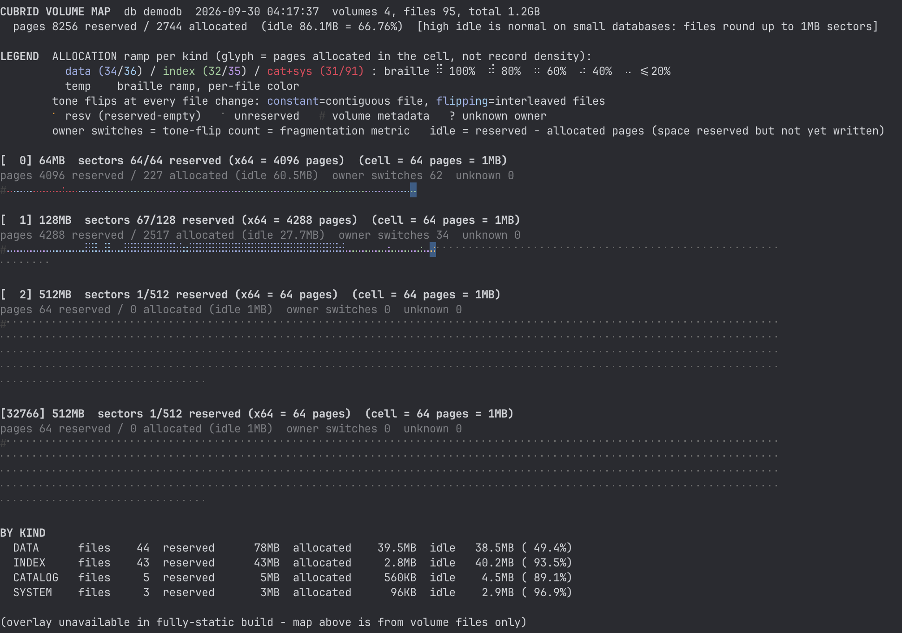
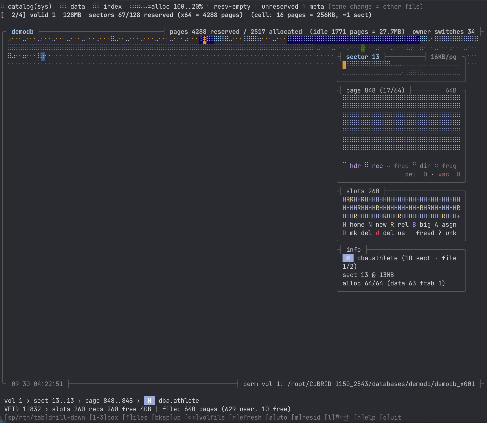
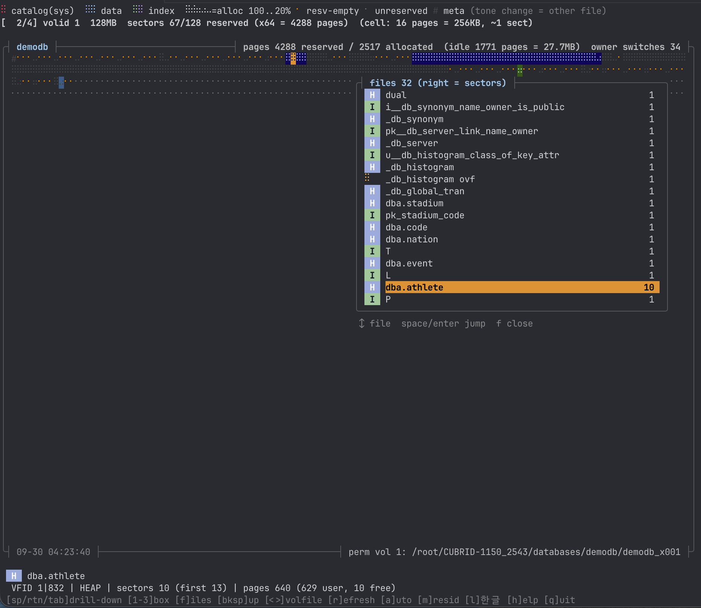

# cub_volmap

CUBRID 볼륨의 섹터·페이지 배치를 객체 단위 지도로 보여 주는 진단 보조 시각화 유틸리티다.
**서버에 접속하지 않고** 볼륨 파일을 직접 읽는다.

**지원 버전: CUBRID 10.1 이상**의 볼륨. 10.0 이하(9.x 포함)는 10.1 디스크 재설계 이전 포맷이라 읽지 않는다 —
그런 DB 를 주면 실행 시작 전과 종료 시 경고하고, 볼륨은 손상이 아니라 미지원으로 건너뛴다([종료 코드](#종료-코드)).



배치 모드 — 볼륨별 지도와 종류별 집계(`BY KIND`)를 한 화면에 낸다.

## 누구를 위한 도구인가

- 장애 원인과 영향 범위를 찾는 **기술지원·DBA** — 기동되지 않는 DB나 볼륨 사본도 연다
- 공간이 어느 객체에 어떻게 묶여 있는지 보고 정비 대상을 고르는 **운영 DBA**
- CUBRID 저장 구조를 이해하거나, 그 개선 근거를 찾는 **개발자**

볼륨의 상태 정보를 보충하고 전달하는 **시각 자료**를 만든다.

## 무엇을 푸는가

| 질문 | 답하는 방식 |
|---|---|
| 어떤 테이블·인덱스가 볼륨 어디를 점유하는가 | 섹터별 소유 파일 색 지도 + 오프라인 객체명 해석 |
| 파일이 얼마나 섞여 있는가(조각화) | 파일 경계 톤 반전, `owner switches` 카운트 |
| 정비 후보는 무엇인가 | 단편화 Top-N (익스텐트 × 규모 점수, 매체 판정 병기) |
| 예약만 하고 안 쓰는 공간은 얼마인가 | `resv-empty` 글리프 + `idle` 집계 |
| 어디가 OS 캐시에 있는가 | mincore 상주율 배경색 (`-m`) |
| 어느 페이지가 서버 버퍼풀에 있는가 | `--bufmap` 중첩 (청록=상주, 자주=dirty) |
| 페이지 내부는 어떻게 생겼는가 | 섹터 → 페이지 → 슬롯 3단 드릴다운 |
| 볼륨 메타데이터에 이상 구조가 있는가 | `--check` 소견(위치 제시 — 판정은 `checkdb`), `--format=json` |

## 특징

| | |
|---|---|
| **락 0 / 쓰기 0** | 볼륨 파일을 읽기 전용으로 열고 락을 잡지 않는다 |
| **서버 무접촉** | 볼륨 파일을 `O_RDONLY`로 해석. 페이지 버퍼·락 테이블 미접근 |
| **의존 0** | 정적 빌드 시 1.3MB 파일 하나 |
| **온/오프라인 무관** | 기동 중 DB와 정지된 DB를 모두 연다. 실행 중인지는 판정하지 않으며, 결과는 참고용이다. 실행하면 읽는 양은 [읽기량](#실행-중-db에서-쓸-때)을 보고 판단한다 |
| **오프셋 하드코딩 0** | 페이지·볼륨 구조체는 엔진 헤더(`file_io.h` 등)를 `#include` — 오프셋은 컴파일러가 계산한다. 단 파일 디스크립터 구조체는 사본(`storage_ondisk_layout.hpp`) |
| **손상 비은폐** | 미할당은 `(unallocated)`, 이상값은 `corrupt?`로 그대로 노출 |

## 빌드

빌드본은 리포에 없다. 아래 두 방법 중 하나로 빌드한다.

### ① 소스 체크아웃 없이 — 헤더만 내려받아 빌드 (권장)

```sh
sh tools/build_fetch.sh                    # 기본 ref = develop
REF=v11.4.6.1963 sh tools/build_fetch.sh   # 특정 태그
REF=v10.2.18     sh tools/build_fetch.sh   # 구버전도 가능
```

volmap 이 포함하는 헤더 **23개**(+버전에 따라 선택 1개)만 GitHub 에서 받고,
CMake 생성물(`config.h`·`version.h`)은 스크립트가 직접 만든다.
clone·cmake·빌드 트리 모두 불필요하다.

**검증된 버전** — 전부 빌드·실행 확인. 목록은 `sh tools/check-releases.sh` 가 GitHub
Releases 에서 각 major.minor 최신 태그를 읽어 다시 만든다(온디스크 구조체 변화도 함께 본다):

| 태그 | 결과 |
|---|---|
| `v10.2.18` | OK (아래 구버전 호환 참조) |
| `v11.0.16` | OK |
| `v11.1.0.0441` | OK |
| `v11.2.9.0868` | OK |
| `v11.3.5.1280` | OK |
| `v11.4.6.1963` | OK |
| `develop` | OK |

10.1 태그로는 빌드하지 않는다 — volmap 이 포함하는 헤더 23개 중 7개(`cubrid_getopt.h`,
`dbtype_def.h` 등)가 10.1 트리에 없다. 10.1 볼륨은 위 버전으로 빌드한 바이너리가 읽는다.

### ② CUBRID 소스가 이미 있을 때

```sh
SRC=/path/to/cubrid-src bash tools/build_standalone.sh
```

`BUILD` 기본값은 `$SRC/build_release` 이다. `config.h` 가 있는 CMake 빌드 디렉터리가 필요하며,
다른 위치면 `BUILD=/path/to/build` 로 지정한다.

### 산출물

산출물은 `cub_volmap` 하나다. 빌드 호스트에 `glibc-static` 이 있으면 완전 정적(약 1.3MB,
glibc 참조 없음)이고, 없으면 같은 경로에 glibc 동적 바이너리가 만들어진다 — 이때는 빌드
호스트의 glibc 이상이 대상에 필요하다. 어느 쪽인지는 빌드 끝에 출력된다.

커널 하한은 빌드 호스트의 glibc 가 정한다 — `readelf -n` 의 `NT_GNU_ABI_TAG` 로 확인한다.
glibc 2.34 호스트에서 빌드하면 커널 3.2 이상을 요구한다. 더 낮은 커널이 대상이면 그 장비에서
직접 빌드한다(C++17 컴파일러 필요, RHEL 6 은 devtoolset).

### 구버전 호환 (build_fetch.sh 가 자동 처리)

| 차이 | 처리 |
|---|---|
| `memory_cwrapper.h` 가 11.4 부터 존재 | 선택 헤더로 두고, 없으면 건너뛴다 |
| `file_io.h` 가 lz4·lzo 헤더를 include (10.2~11.4) | volmap 은 압축 심볼을 쓰지 않으므로 빈 스텁으로 충족. 10.2 는 구조체 필드가 `lzo_uint` 타입이라 typedef 3개만 제공 |
| TDE 플래그 필드명이 10.2 는 `pflag_reserve_1`, 11.0+ 는 `pflag` | 레이아웃은 동일(prv 32B)하고 이름만 다르다. 헤더를 보고 `-Dpflag=pflag_reserve_1` 을 자동으로 붙인다 |

상세는 [docs/build.md](docs/build.md).

## 사용

```sh
cub_volmap --check --plain <db>                # 배치: 지도 + 이상 구조 소견
cub_volmap -i <db>                             # 인터랙티브
cub_volmap -i -m --bufmap=/tmp/bcb.dump <db>   # 캐시 + 버퍼풀 중첩
cub_volmap --check --format=json <db> -o out.json
cub_volmap --help                              # 옵션 목록
```

`--bufmap` 은 `cub_top --bcb-dump` 가 남긴 버퍼풀 스냅샷 파일을 읽는다.

### 종료 코드

| 코드 | 뜻 |
|---|---|
| 0 | 정상 (소견 없음) |
| 1 | **사용법 오류** — 알 수 없는 옵션, 인자 누락, DB 두 개 지정, `--format` 값 오류. 또는 실행 불가 — vinf 를 읽을 수 없음, `--deep` 권한 부족 |
| 2 | `--check` / `--warn-idle` 소견 있음 (헤더가 손상된 볼륨, 판별 불가 헤더 포함) |
| 3 | vinf 에 있는 볼륨 중 열지 못한 것이 있음 — 보고가 불완전하다. 목록과 이유는 출력의 `SKIPPED VOLUMES`(JSON `skipped_volumes[]`). 10.1 미만 DB 의 볼륨도 여기에 든다 |

2 와 3 이 겹치면 2 를 낸다. 그래서 종료 코드만으로는 보고가 불완전한지 알 수 없다 — 자동화에서 보고가
완전한지 판단하려면 JSON 의 `skipped_volumes` 가 비어 있는지 확인한다.

**소견은 참고 자료다.** 볼륨 메타데이터를 읽어 이상해 보이는 구조의 **위치**를 알려 줄 뿐, 손상 여부를 판정하지
않는다. 실행 중 DB 의 시차, 찢어진 페이지 읽기로도 소견이 생길 수 있다. 종료 코드 2 를 복구·정비의 근거로 바로
쓰지 말고, 판정은 `checkdb` 등 엔진 도구로 한다([하는 것과 하지 않는 것](#하는-것과-하지-않는-것)).

DB 이름 대신 vinf 경로를 직접 줄 수 있다. 같은 이름의 DB 가 여러 설치본에 있을 때 모호하지
않다.

```sh
cub_volmap -i /path/to/databases/<db>/<db>_vinf
```



인터랙티브 모드 — 지도에서 셀을 고르면 오른쪽 4박스가 섹터 → 페이지 → 슬롯 순으로
이어서 열린다. 위 화면은 `dba.athlete` 의 페이지 848 로, 슬롯 260개가 `H`(home)와
`R`(relocation)로 섞여 있다.

### 주요 키

| 키 | 동작 |
|---|---|
| `space`·`enter` | 한 단계 드릴다운 (지도 → 섹터 → 페이지 → 슬롯 → 지도) |
| `bksp` | 한 단계 위 · `1`/`2`/`3` 박스 직행 · `tab` 열기/닫기 |
| `←→↑↓` | 박스 안 선택 (위에서 고르면 아래가 따라 바뀐다) |
| `<` `>` | 볼륨 순환 · `[` `]` 페이지 순회 |
| `f` | 파일 뷰 — 고른 파일 셀만 남색, 나머지는 회색 |
| `p` | 논리 체인 뷰 — 힙 페이지 체인 순차율·점프 통계 |
| `r` / `a` | 새로고침 / 자동 새로고침 · `m` 캐시 상주 · `b` 버퍼풀 |
| `h` | 도움말 (스크롤 문서) · `l` 한/영 · `g` ASCII 테두리 · `q` 종료 |

마우스 클릭은 인스펙션, 더블클릭은 드릴다운이다.
`[r]` 는 지도뿐 아니라 **볼륨 목록도 재스캔**한다 — temp 볼륨은 쿼리가 spill 하는 동안만
존재하므로, 새로 생긴 것은 넣고 사라진 것은 뺀다.

### temp 볼륨이 다른 디스크에 있을 때

엔진은 `temp_volume_path` 가 설정돼 있으면 **그 경로에** temp 볼륨을 만든다(없으면 DB
디렉터리). spill 볼륨을 별도 디스크에 두는 구성이 흔하므로, volmap 도 두 곳을 모두 본다.

| 우선순위 | 출처 |
|---|---|
| 1 | `--temp-path=DIR` |
| 2 | `cubrid.conf` 의 `temp_volume_path` — `[@<db>]` 가 `[common]` 보다 우선(엔진과 동일) |
| 3 | DB 디렉터리 (설정이 없을 때) |

설정 파일은 `$CUBRID_CONF_FILE`, 없으면 `$CUBRID/conf/cubrid.conf` 를 읽는다.

temp 경로를 바꾼 뒤에는 이전 디렉터리에 남은 `<db>_t<volid>` 를 엔진이 지우지 않는다. 그래서 같은
volid 가 두 곳에 있으면 **엔진이 쓰는 디렉터리(위 표의 1·2, 없으면 3)의 파일을 표시**한다. 다른
디렉터리의 파일은 그 volid 가 엔진 디렉터리에 없을 때만 표시하고, `[r]` 새로고침 때 엔진 디렉터리에
같은 파일이 생기면 그것으로 교체한다. 두 경로가 같은 디렉터리인지는 표기가 아니라 장치·inode 로
판정한다(끝 슬래시·심볼릭 링크·상대경로).

## 화면 읽는 법

**계층** — 볼륨 └ 섹터(64페이지=1MB) └ 페이지(16KB) └ 슬롯 └ 레코드

| 요소 | 의미 |
|---|---|
| 색 | 소유 파일 종류 (파랑=데이터 힙, 초록=인덱스, 빨강=카탈로그/시스템) |
| 채움 `⠿⠾⠶⠴⠤` | 셀 안 할당률 100/80/60/40/20% |
| 톤 반전 | 파일 경계 — 잦은 반전 = 조각화 |
| `⠂` 주황/회색 | 예약-빈 / 미예약 |
| `#` | 볼륨 메타데이터 · `?` 소유자 미상 · `E` TDE 암호 |

**슬롯 9종**: `H` home · `N` newhome · `R` relocation · `B` bigone · `D` mk-del ·
`d` del-us · `A` asgn · `-` freed · `?` unknown(손상 후보)

슬롯 구조가 아닌 페이지는 **왜 아닌지**를 함께 알린다 — `slots n/a - qresult page`.
temp 볼륨은 대부분 AREA(작업공간)·QRESULT(정렬 결과)이고, 이들은 OID 로 참조되지 않으므로
슬롯 디렉터리가 없는 것이 정상이다.



`[f]` 파일 뷰 — 이 볼륨의 섹터를 가진 파일 목록. 고른 파일(`dba.athlete`, 10섹터)의
셀만 지도에 남색으로 남고 나머지는 회색으로 죽어, 그 파일이 어디에 흩어져 있는지가
한눈에 보인다.

상세는 [docs/views.md](docs/views.md).

## 왜 이 도구인가

CUBRID 볼륨 파일을 엔진 밖에서 직접 해석해, **볼륨의 형상을 객체 단위 지도로 보여 주는 진단 보조 시각화 유틸리티**다.
정지된 DB, 백업·복사본, 실행 중 DB 어디서든 **그 순간 디스크에 있는 그대로**를 보여 준다. 실행 중 DB에서 보이는
것은 그 시점의 디스크 상태이고, 버퍼에만 있는 변경은 아직 거기 없다 — 그것도 사실이므로 보정하거나 감추지 않는다.
결과는 **판정의 참고용**이며, 무결성 판정은 `checkdb`, 공간 총량은 `spacedb`가 맡는다.

### 핵심과 부가 기능

| 층 | 기능 | 읽는 양 |
|---|---|---|
| **핵심** — 볼륨 파일 안의 현재 상태를 정확히 보여 준다 | 기본 실행, `-i`, `--check`(이상 구조의 위치), `--format=json` | 메타데이터와 예약 섹터의 첫 페이지 ([읽기량](#실행-중-db에서-쓸-때)) |
| **부가** — 더 자세히, 더 넓게 본다 | `--deep`(페이지 내용 집계), `-m`(OS 캐시), `--bufmap`(`cub_top` 스냅샷의 버퍼풀), `--warn-idle`(용량 경보) | `--deep` 만 예약 공간 전체. 나머지는 핵심과 같다 |

부가 기능의 부담은 그 기능을 켰을 때만 생긴다. 운영 중 사용 여부는 층별로 따로 판단한다.

### 하는 것과 하지 않는 것

| 하는 것 | 하지 않는 것 |
|---|---|
| 섹터·페이지·슬롯 배치를 테이블·인덱스 이름으로 보여 준다 | 정합성 판정 → `checkdb` |
| 이상 구조의 **위치**를 소견으로 제시한다 (`--check`) | 공간 총량 보고 → `spacedb` |
| 정지 DB, 백업·복사본, 다른 버전의 볼륨을 연다 | 수리, 쓰기, 엔진 기동 |
| 실행 중 DB의 배치·캐시 상태를 그 순간의 디스크 그대로 관측한다 | 실행 중 관측값을 확정값으로 제시, 버퍼 미반영분의 보정 |

### 대표 사용 시나리오

**S1. 장애 사후 분석 — 기술지원·DBA**

| 단계 | 내용 |
|---|---|
| 상황 | 서버가 기동되지 않거나, 장애 직후의 볼륨 사본만 있다. 엔진 버전이 다르거나 로그가 없을 수 있다 |
| 확인 | ① 볼륨 포맷의 버전대 (볼륨 자체에서 판별) ② 출력 머리의 `log:` 줄 — 마지막 종료가 정상인지 ③ `--check` 소견이 **어느 객체의 어느 섹터·페이지**에 있는지 ④ 드릴다운으로 해당 페이지의 헤더·슬롯 상태 |
| 다음 조치 | 영향 범위를 객체 단위로 좁혀 복구 방식을 정한다(부분 언로드, 인덱스 재생성, 백업 복원). `log:` 가 **정상 종료 아님**이면 볼륨은 재시작 복구 전 상태다 — 로그에만 있는 변경이 아직 반영되지 않았고, 재시작이 이중 쓰기 버퍼(DWB)로 교체할 찢어진 페이지가 있을 수 있다. 그 상태의 소견을 손상으로 단정해 백업 복원 같은 무거운 조치를 고르지 말고, 가능하면 재시작 복구 뒤 다시 본다. 엔진을 기동할 수 있게 되면 `checkdb`로 확정한다 |
| 이 도구를 쓰는 이유 | `checkdb`·`diagdb`는 엔진 기동이 필요해, 버전이나 로그가 맞지 않는 사본을 열 수 없다. volmap은 볼륨 파일만 있으면 된다 |

**S2. 공간 정비 계획 — 운영 DBA**

| 단계 | 내용 |
|---|---|
| 상황 | 볼륨이 계속 커지는데 원인 객체를 모른다 |
| 확인 | ① 객체별 예약 후 빈 공간(`resv-empty`, `idle`) ② 단편화 Top-N ③ `BY KIND` 집계 |
| 다음 조치 | 대상 객체를 골라 재구성한다(compactdb, 인덱스 재빌드, 테이블 재생성). 볼륨 추가·분리를 계획하고, 정비 후 다시 열어 비교한다. 정기 점검에는 `--warn-idle=PCT` 를 참고 경보로 쓸 수 있다(idle 이 PCT% 이상인 볼륨을 소견으로 보고, 종료 코드 2) |
| 이 도구를 쓰는 이유 | `spacedb`는 볼륨·목적별 **총량**을 보여 준다. volmap은 그 공간이 **어느 객체에, 어디에** 묶여 있는지를 보여 준다 |

### 판단 근거의 보충과 전달

DBA나 관계자가 볼륨의 문제를 의심할 때, 그 의심을 **보여 줄 수 있는 자료**로 만든다.

| 쓰임 | 내용 |
|---|---|
| 판단 근거 보충 | "이 인덱스가 단편화된 것 같다", "이 테이블에 예약만 하고 쓰지 않는 공간이 많다" 같은 의심을, 객체 이름이 붙은 지도와 페이지·슬롯 상태로 확인한다 |
| 의심 내용 전달 | 확인한 화면을 그대로 캡처해 개발자·기술지원·동료에게 전달한다. 수치 나열 대신 "어디가 어떻게 놓여 있는지"를 한 장으로 보인다 |
| 개선 근거의 사례 | 슬롯 페이지 구조, 인덱스·힙의 분포가 합리적이지 않은 상황을 실제 화면으로 남겨, 엔진이나 운영 방식을 개선하는 논의의 참고 자료로 쓴다 |

이런 자료가 따로 필요한 이유는, 기존 도구가 저장 구조의 **분포**를 사람이 바로 읽을 수 있는
형태로 보여 주지 않기 때문이다.

| 도구 | 하는 일 | 분포를 보여 주는 데의 한계 |
|---|---|---|
| `spacedb` | 볼륨·목적별 공간 총량 | 어느 객체가 어디에 있는지는 보여 주지 않는다 |
| `diagdb` | 내부 구조 텍스트 덤프 | 해석에 엔진 구조 지식이 필요하고, 분포를 한눈에 볼 수 없다 |
| `checkdb` | 정합성 검사 | 인덱스 검사 등은 오류 로그에 위치(인덱스·클래스·OID)를 남기지만 분포를 한눈에 보여 주지는 않는다. 섹터 누수 검사는 위치 없이 유무만 알린다 |

volmap의 결과는 판정이 아니라 **판정의 근거를 보충하는 자료**다. 확정은 엔진 도구로 한다.

### 실행 중 DB에서 쓸 때

volmap 은 DB 가 실행 중인지 판정하지 않는다. 쓰기와 락은 없고 필요한 메타데이터만 읽도록 만들었지만, 읽기 I/O 는
있다. 실행 중인 운영 DB 에서 돌릴지는 아래 읽기량을 보고 판단한다.

**읽기량의 예측** — 캐시가 비어 있을 때 디스크에서 읽는 양. 어느 디스크든 양은 같고, 걸리는 시간만 디스크에 따라 다르다.
실측은 2.7GB~97GB, 3~61 볼륨, 74~792 파일의 DB 다섯 개에서 쟀다.

| 모드 | 언제 | 얼마나 (계산식) | 실측 예 |
|---|---|---|---|
| 기본 실행, `--check`, `-m`, `-i` 첫 화면 | 시작 직후 **한 번**, 한 묶음으로 요청해 끝난다 | **≈ 3.5MB × 볼륨 수 + 16KB × 파일 수** (볼륨당: 헤더·섹터 테이블과 OS 리드어헤드, 파일당: 헤더 1페이지; 2GB 가 넘는 파일은 2GB 마다 파일 테이블 1페이지 추가; 어느 파일도 소유하지 않는 섹터는 하나당 4KB 추가) | 97GB · 9 볼륨 · 76 파일 → 31MB / 50GB · 61 볼륨 · 74 파일 → 202MB / 16.6GB · 30 볼륨 → 100MB / 2.7GB · 4 볼륨 · 792 파일 → 26MB / 768MB · 3 볼륨 → 11MB |
| 파일 트래커를 못 읽을 때 | 위와 같은 때 | 위 양 + 소유자 미상 섹터 × 4KB (소유가 확정된 섹터는 건너뛴다) | 97GB → 83MB |
| 자동 2차 탐색 / `--full-sweep` | 첫 탐색 직후 한 번 | 소유자 미상 섹터 × 1MB. 자동은 256 섹터(256MB)까지, 그 이상은 `--full-sweep` 때만 | 정상 DB 는 0~수십 MB |
| `-i` 새로고침(`r`, 자동 틱 기본 2초) | 틱마다 | 섹터 테이블·파일 테이블·트래커 재독: **수백 KB** (90GB 에서 pread 128회) | — |
| `-i` 드릴다운·패널 | 커서가 섹터로 갈 때마다 | 그 섹터 **1MB 를 한 번에** | — |
| `--bufmap` | 시작, 그리고 스냅샷 파일이 바뀐 틱마다 | 스냅샷 파일 크기 (버퍼 수 × 32B; 512MB 버퍼풀 ≈ 1MB) | — |
| `--deep` | 시작부터 끝까지 **연속** | **예약 공간 전체**를 볼륨 순서로 순차 읽기. 순간 I/O 는 그 디스크의 순차 읽기 속도만큼이고, 소요 = 예약 공간 ÷ 그 속도. `-V` 로 볼륨을 지정하면 그 볼륨 크기만큼 | 16.6GB 를 약 260MB/s 디스크에서 약 1분 |

기본 실행의 순간 최대는 위 묶음을 한꺼번에 요청(`posix_fadvise(WILLNEED)` 일괄)하는 시작 순간이다 — 수십~수백 MB 를 1초 안쪽에 요청하고,
디스크가 바쁘면 그만큼 늦게 돌아온다. 그 뒤로는 틱당 수백 KB 뿐이다.

| 항목 | 내용 |
|---|---|
| 영향 | 위 읽기량만큼의 읽기 I/O. 같은 디스크를 쓰는 서버의 읽기와 경쟁한다. I/O 의 모양은 모드마다 다르다 — 기본 실행·`-i` 는 수십 MB 를 한 번 읽고 끝나는 짧은 묶음이라 `backupdb` 와 겹쳐 돌려도 백업 소요에 차이가 없었다. `--deep` 은 예약 공간 전체를 볼륨 순서로 **연속해서 읽는** I/O 라 디스크 처리량을 그 시간 동안 나눠 쓴다. 16.6GB 를 백업과 겹쳐 읽었을 때 백업이 약 15% 늦어졌고, 영향 시간은 예약 공간을 그 디스크의 순차 읽기 속도로 나눈 만큼이다(하드웨어마다 다르다) |
| 옆에서 도는 것 | `/proc` 만 읽어 서버 상태(실행 중 / 기동·복구 중 / 없음)와 이 DB 의 유틸리티(`backupdb`·`checkdb` 등), 디스크 busy% 를 출력 머리에 적는다. `-i` 는 유틸리티·복구 중이면 스캔·자동 새로고침을 멈추고(`r` 로 계속), 디스크가 바쁘면 스캔을 늦춘다. 감지하지 못하는 것(서버 내부 작업, 다른 호스트의 유틸리티 등)은 [usage.md](docs/usage.md#옆에서-도는-것의-감지-proc-만-읽는다) |
| 대량 I/O 중 | `backupdb`·`loaddb`·`checkdb` 처럼 디스크를 오래 점유하는 작업과 겹치면 **volmap 쪽이 느려진다** — 읽기가 그 작업 뒤에 줄을 서기 때문이다. 그런 작업이 도는 동안은 쓰지 않기를 권한다. 그래도 열어야 할 때를 위해 `-i` 는 이 DB 의 유틸리티나 서버 복구를 감지하면 스캔·자동 새로고침을 **스스로 일시 정지**하고 헤더에 이유를 보이며, 끝나면 재개한다(`r` 로 기다리지 않고 계속할 수 있다). 디스크가 80% 이상 바쁘면 스캔을 짧은 슬라이스로 늦춘다. 배치 실행은 멈추지 않고 머리에 적기만 한다 |
| 권장 | 운영 중에는 기본 모드로 쓰되, 쓸지 여부는 위 읽기량 표와 대량 I/O 작업 여부를 보고 DBA가 정한다. 백업·loaddb 같은 작업이 도는 동안은 쓰지 않는다. `--deep`·`--full-sweep`은 부하가 적은 시간이나 사본에서 쓴다 |
| `--deep` | **운영 중 I/O 에 영향을 줄 수 있다.** 문제를 조사하는 중이라면 필요한 볼륨만 `-V` 로 지정해 읽는 양을 그 볼륨 크기로 줄이고, 영향이 걱정되면 부하가 덜한 시점을 고르거나 사본에서 본다. 읽어 들인 페이지 캐시는 섹터마다 바로 반납하고, 반납 범위는 그 섹터와 그 뒤의 리드어헤드 창(장치의 `read_ahead_kb`, 보통 128KB~4MB)뿐이다. 스캔 중 서버가 그 창 밖에서 올린 페이지는 건드리지 않으므로, 서버의 캐시를 밀어내는 양은 섹터 하나와 그 창 정도다 |
| 보이는 것 | 디스크에 반영된 배치, OS 캐시 상주(`-m`), `cub_top` 스냅샷 시점의 버퍼풀 상주·dirty(`--bufmap`) |
| 보이지 않는 것 | 버퍼에서 아직 디스크로 내려가지 않은 변경. 디스크 읽기와 버퍼 스냅샷의 시점 차이. 서버가 쓰는 도중의 페이지는 찢어져 보일 수 있다(소견으로 표시). 이것들은 "그 순간 디스크에 없다"는 사실이지 오류가 아니며, volmap 은 보정하지 않는다 |
| 쓰는 법 | 가설을 세우는 참고로 쓰고, 확인은 엔진 지표(`statdump`, `cub_top` 수치)로 한다 |

## 문서

| 문서 | 내용 |
|---|---|
| [docs/architecture.md](docs/architecture.md) | 데이터 수집, 3 레인 스레드, 렌더 파이프라인 |
| [docs/views.md](docs/views.md) | 화면 구성과 글리프 문법 |
| [docs/usage.md](docs/usage.md) | 옵션·키·트러블슈팅 |
| [docs/build.md](docs/build.md) | 빌드 방법과 버전 호환 |
| [docs/ondisk-format.md](docs/ondisk-format.md) | 온디스크 구조와 버전 변천 |
| [docs/limitations.md](docs/limitations.md) | 제한 사항과 검증 매트릭스 |

## 제한

- 대상 볼륨은 10.1 이상이다.
- TDE 볼륨의 암호화 페이지는 감지만 하고(`E`) 복호하지 않는다.
- 실행 중인지 판정하지 않는다. 기동 중 DB 에서는 스냅샷과 현재 상태에 시차가 있을 수 있다(`--check` 가 소견으로 보고).
- 출력 머리의 `log:` 줄은 액티브 로그 헤더의 `is_shutdown` 이다 — 정상 종료 / 정상 종료 아님(실행 중이거나 복구 전) / 미상(로그 없음).
- temp 볼륨은 수명이 짧아 화면과 실제가 어긋날 수 있다. `[r]` 가 재스캔하지만 그 순간의 스냅샷이다.

## 라이선스

Apache-2.0 ([LICENSE](LICENSE)) — CUBRID 엔진·본 리포와 동일. 유래 고지는 [NOTICE](NOTICE) 참조.
